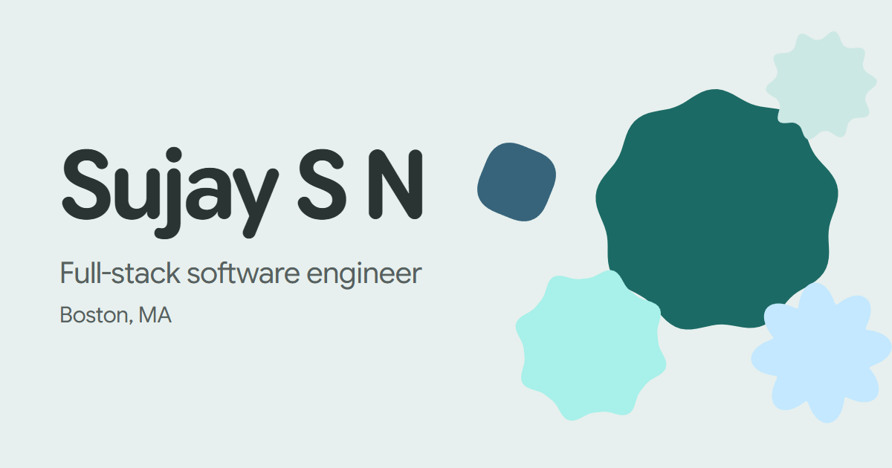

<p align="center">
  
</p>

<h1 align="center">The Adaptive Artisan</h1>

<p align="center">
  My portfolio, built as a working Material 3 Expressive design system.<br>
  Every color, letterform, shape, and spring on the page is live, and visitors can make it their own.
</p>

<p align="center">
  
  
  
  
  
</p>

---

## About

Most portfolios describe their author's skills. This one tries to demonstrate them. The site is a from-scratch implementation of Google's Material 3 Expressive design language for the web: the 2025 dynamic color spec, a variable-font type system, the Expressive shape library, and spring-based motion, all driven by design tokens and built to WCAG 2.2 AA.

It is also a working tool. Pick a seed color or drop in a photo, and the whole site re-themes itself the way an Android phone does from its wallpaper.

## Highlights

**Dynamic color.** Themes come from Google's `material-color-utilities` on the 2025 spec. One seed color produces every MD3 color role, emitted once as `light-dark()` so light and dark modes switch with no JavaScript. Visitors can choose a seed, any hex value, or a photo. A photo's colors are extracted on the device and never uploaded. Every theme change sweeps across the page in a circular reveal from wherever it was chosen.

**Personalization hub.** The floating action button morphs into a full-screen hub with nine scheme variants, three contrast levels, live type and icon axes, a motion scheme switch, and opt-in sound. Changes preview inside the hub and reach the site only when applied.

**Type as a design element.** One family, Google Sans Flex, does all the work. The headline letters respond to the cursor on their weight, width, and roundness axes, and section titles settle their axes as they arrive. A custom display subset keeps the font small, and the full font loads only when someone opens the personalization hub.

**Shape and motion.** Thirteen shapes from the Expressive library are approximated as radial functions that share 144 sample points, so any shape can morph into any other. MD3 spring tokens are compiled at build time into CSS `linear()` easings, so components spring with no animation JavaScript. Spatial springs may overshoot; effect springs never do.

**Sections with personality.** Skills are a jar of Material shapes you can drop, drag, and throw. The experience timeline draws itself as you read. The footer is a small room on Boston time, where an illustrated version of me walks to whatever I am doing at that hour: coursework at the desk, gaming on the couch, or asleep with the lamp off.

**Real pages for projects.** Each project has its own prerendered page, with a card-to-page morph, a gallery viewer, and shareable links. The project list filters by skill, and the filter lives in the address.

**Fast first paint.** Every route is prerendered to static HTML and hydrated in the browser. A small pre-paint script restores a returning visitor's theme before the first frame, so nothing flashes. Heavy features (the hub, the skills physics, layout animation) load only when needed.

## Accessibility

Accessibility is a requirement here, not a later pass.

- Every theme, across all seeds, scheme variants, contrast levels, and modes, is tested for WCAG contrast. Thousands of checks run with the test suite.
- Automated axe audits pass on every page in light and dark, from phone to wide desktop.
- Full keyboard support: one tab stop per control, visible focus rings that follow each control's shape, and focus that returns to where you were after back navigation.
- Status changes are announced to screen readers, including filter results and gallery position.
- Reduced motion is respected per component, and any ambient animation can be paused (WCAG 2.2.2).
- Controls keep MD3's visual sizes while meeting a 48px minimum hit area.

## Tech stack

| Area | Choice |
| --- | --- |
| Framework | React 19 with the React Compiler |
| Language | TypeScript 6 |
| Build | Vite 8 with a custom plugin for theme, motion, and font tokens, plus a prerender step |
| Styling | Tailwind CSS 4, mapped entirely to MD3 tokens (the default palette and scales are cleared) |
| Color | `@material/material-color-utilities`, 2025 spec |
| Components | Native elements first (`<dialog>`, checkbox switches), Base UI where nothing native fits |
| State | Zustand |
| Motion | CSS springs from MD3 tokens; Motion only for layout animation, loaded on demand |
| Testing | Vitest, with contrast, content, routing, and physics suites |

## Getting started

You need **Node.js 22.12 or later**.

```bash
git clone https://github.com/sujay-sn/adaptive-artisan.git
cd adaptive-artisan
npm install
npm run dev
```

While the dev server runs, open `/?gallery` to see every component in the library.

### Scripts

| Command | What it does |
| --- | --- |
| `npm run dev` | Starts the dev server |
| `npm run build` | Typechecks, builds the client and server bundles, and prerenders every page to `dist/` |
| `npm run preview` | Serves the production build locally |
| `npm test` | Runs the test suite, including the contrast and content checks |
| `npm run typecheck` | Runs TypeScript without emitting files |
| `npm run lint` | Runs ESLint |
| `npm run fonts` | Rebuilds the display font subset in `public/fonts` |

## Editing content

Everything about me (profile, experience, education, projects, skills, awards, certifications, and the footer's daily routine) lives in one file: [`src/data.ts`](src/data.ts). Its header explains the common edits.

The content is typed and validated on every build and test run. A misspelled field, a skill that does not exist, a duplicate id, or routine hours out of order stop the build and name the exact problem.

## Project structure

```
src/
├── data.ts          All site content, in one place
├── theme/           Color engine, light and dark, theme reveal, first-visit bloom
├── motion/          MD3 spring tokens and their CSS easings
├── shape/           The Expressive shape library on shared sample points
├── ui/              Component library: buttons, chips, cards, fields, dialogs
├── hub/             The personalization hub and its draft-then-apply model
├── sections/        Home page sections, from the hero to recognition
├── skills/          The jar of shapes and its in-house Verlet physics
├── footer/          The room on Boston time and its character
├── projects/        Project cards, rows, covers, and the gallery
├── pages/           Routes: home, projects, project, not found
├── router.ts        A small in-place router with prerendered pages
└── seo/             Social cards and structured data, generated from content
scripts/             Build plugin, prerender, and font subsetting
```

## Deployment

The build output in `dist/` is static and can be hosted anywhere. Two environment variables configure it:

| Variable | Purpose |
| --- | --- |
| `SITE_URL` | The site's address, for canonical links, social cards, and structured data |
| `VITE_CONTACT_ENDPOINT` | Where the contact form posts. Until it is set, the form opens the visitor's email app with the message filled in |

## Browser support

Baseline web features are used freely. Newer ones, such as `corner-shape`, scroll-driven animations, and element-scoped view transitions, are feature-detected and never polyfilled, and the page reads correctly without them.

## Acknowledgments

Built on Google's [Material 3 Expressive](https://m3.material.io/) design language, [Material Color Utilities](https://github.com/material-foundation/material-color-utilities), [Google Sans Flex](https://fonts.google.com/specimen/Google+Sans+Flex), and [Material Symbols](https://fonts.google.com/icons). This is an independent project and is not affiliated with Google.

## License

© 2026 Sujay S N. All rights reserved.
